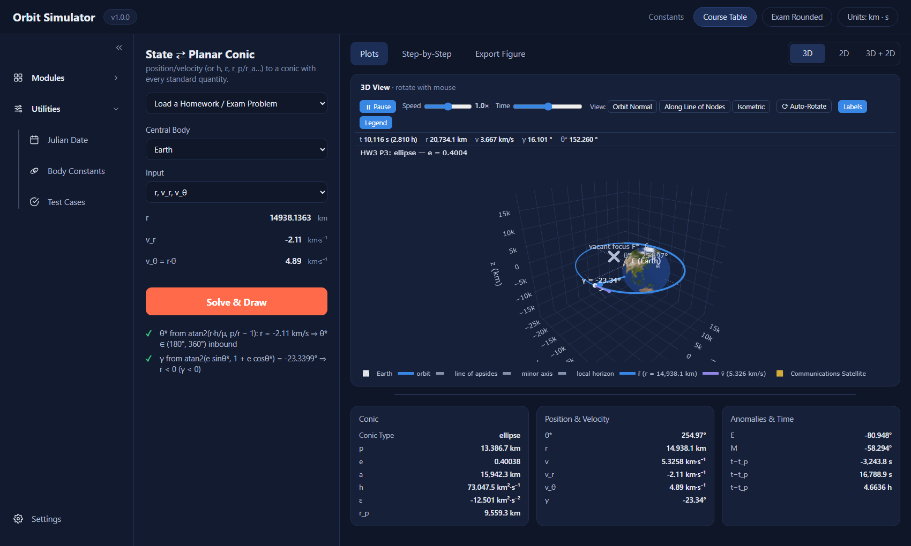
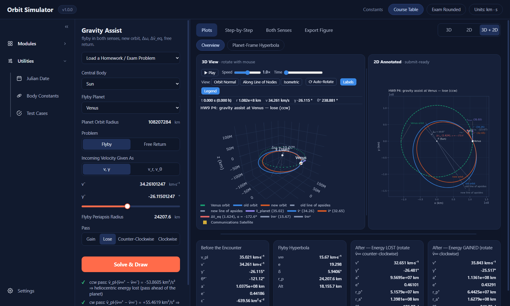
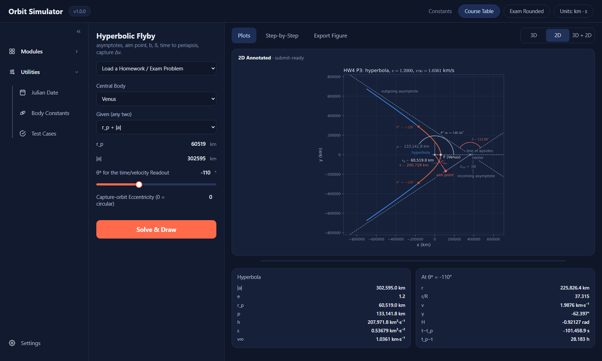
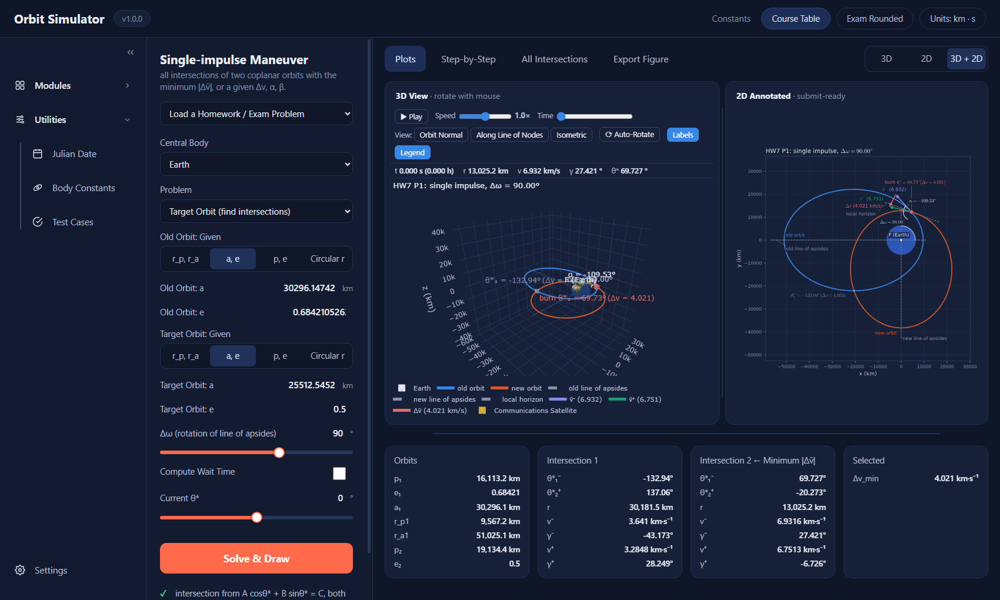
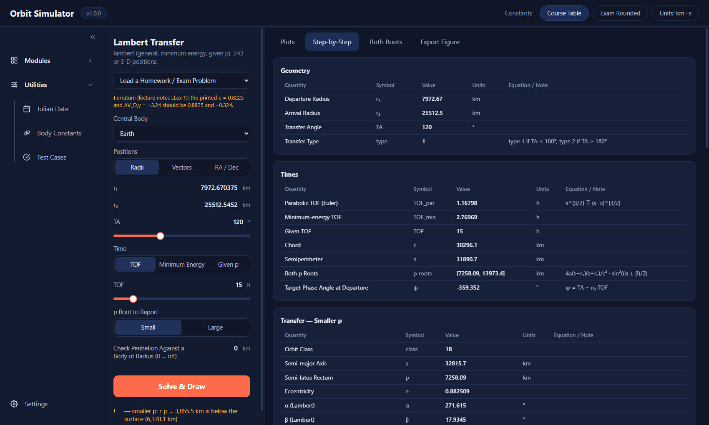
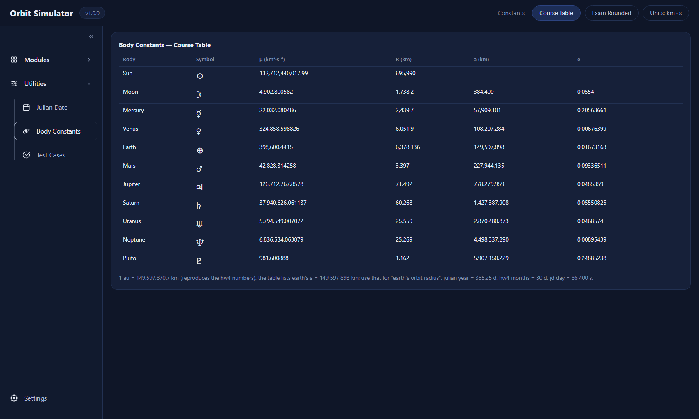
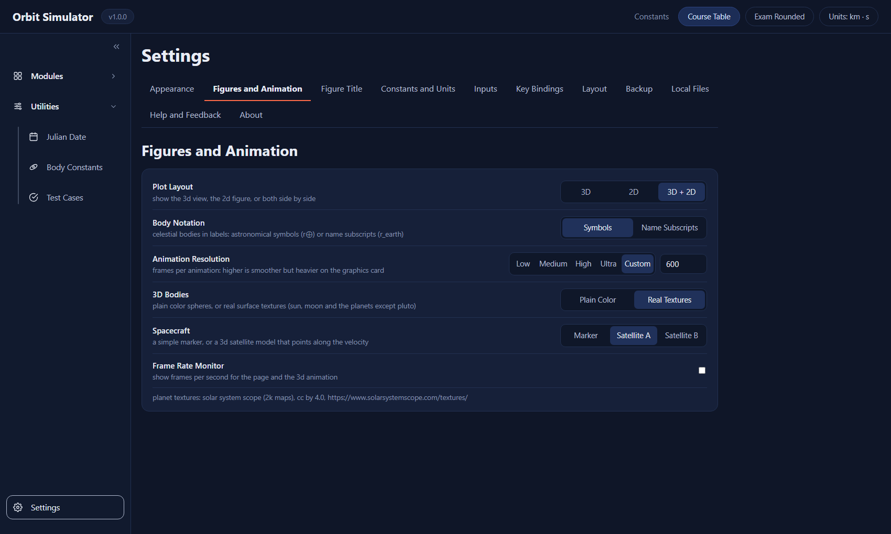
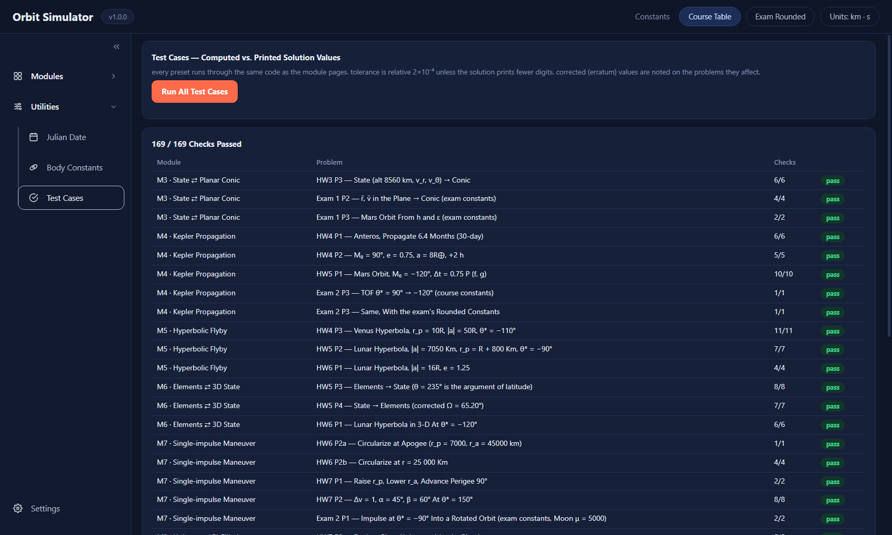
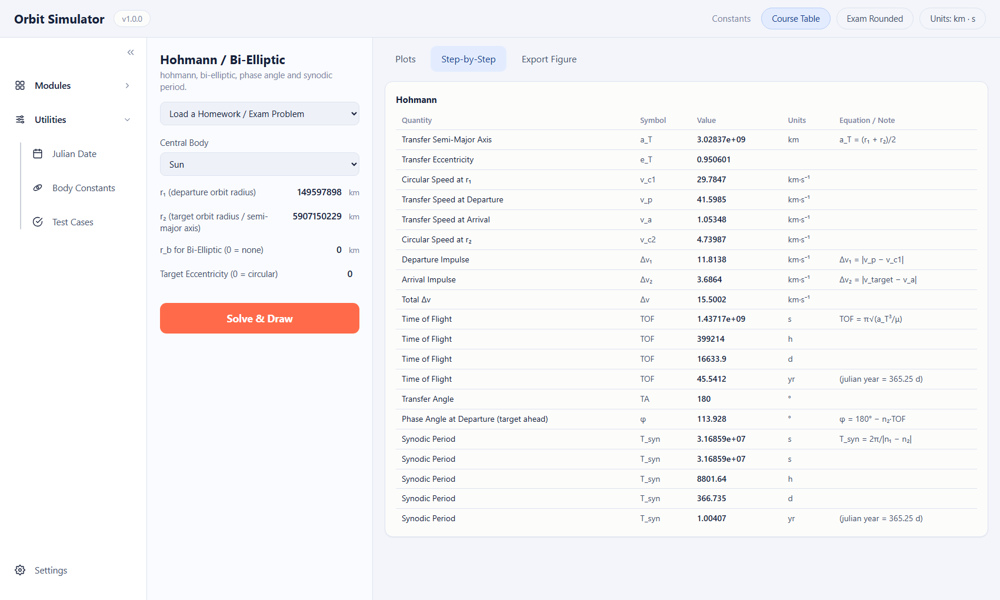

# OrbSim

A desktop app for **orbit-mechanics problems**: it solves the standard two-body / patched-conic problem types step by step, draws annotated 2-D figures
and an interactive 3-D animation, and checks itself against hundreds of published homework and exam answers.

> **Version 1.0.0.** Installers are not published yet; they will appear on the [Releases](https://github.com/Chiyami1213/orbsim/releases) page.

## What it does

OrbSim has two modes, chosen with the switch at the top left:

| Mode | What you do |
|---|---|
| **Solve** | compute homework and exam answers with the twelve course modules, plus the reference tools (Julian date, body constants, test cases) |
| **Design** | GMAT-style mission planning: resources, a command sequence, numerical propagation, comparison with the course answer, GMAT script import and export; and a **Solar System** tab with the real planets at true size from the ephemeris, full orbits, time warp and a focus menu (in the style of Cosmographia) |

**Main menu.** Hover over (or click) the OrbSim icon at the top left of the window to open the main menu; it is the same in every mode and its big actions follow the mode you are in: modules, problems and test cases in Solve; new, open and starter missions in Design. It also holds Save and Share, Preferences, the other mode, what's new, keyboard shortcuts, credits, feedback, debug tools, a frame-rate performance test and help.

### Solve

Twelve modules (Bate–Mueller–White conventions; all equations and sign conventions are written out in [`docs/ai_briefing.md`](docs/ai_briefing.md)):

| | Module | | Module |
|---|---|---|---|
| 1 | N-body accelerations | 7 | Single-impulse maneuver (all orbit intersections, minimum Δv) |
| 2 | Two-body constants | 8 | Hohmann / bi-elliptic transfers, phase angle, synodic period |
| 3 | State ⇄ planar conic | 9 | Plane change (single burn vs three burns) |
| 4 | Kepler propagation with f and g (both forms) | 10 | Patched conics (departure and capture hyperbolas) |
| 5 | Hyperbolic flyby geometry | 11 | Gravity assist (both senses, free return) |
| 6 | Elements ⇄ 3-D state with quadrant checks | 12 | Lambert / two-position problems (both p roots) |

* **Step-by-step tables** with the symbol, equation and units of every intermediate value, plus the quadrant and sanity checks that were performed.
* **2-D figures** in the homework style (Cartesian, equal axes, label collision avoidance, your name and the problem label in the title), exported at 300 dpi. Scroll to zoom the plot, drag to pan, double-click to reset.
* **3-D animation** with play/pause, 0.1×–10× speed, scrubber, view presets, auto-rotate, label and legend toggles, live readout, optional real planet textures (the textured central body turns at its real rotation rate, with a *Spin* button)
  and 3-D satellite models. You can rotate and zoom the view while the animation keeps playing. Frames are uniform in *time* (Kepler's equation), so the motion is physically correct.
* **LaTeX everywhere in figures and exports:** labels such as $a_{\mathrm{tot}}$, $\bar v_\infty$, $\theta^{*}$ are typeset with real sub/superscripts; celestial bodies can be shown
  as symbols (R⊕) or as name subscripts ($R_{\mathrm{earth}}$).
* **Export** figures as PNG / PDF, a standalone 3-D page, or a **Python (matplotlib)** or **MATLAB** script that redraws the plots.
* **Homework presets:** every problem with printed answers (HW 3–10, Fall 2024 exam problems that use the JPL constants, lecture-note examples) loads as a preset, and the *Test Cases* page compares
  computed and printed values. Known errors in the printed solutions are corrected and documented.
* **Solar System view (Design mode):** the real Solar System, no mission needed. Every body of the ephemeris (the Sun, the planets, the Moon and Pluto) is drawn at its true size and real position from DE440s or the built-in model; a Sun-centered view draws each planet's full orbit. Pick a start date, a time span (a month to 100 years) and the body to center on, then use the same time warp (up to 10⁷×, forwards or backwards), focus menu, labels, textures and picture tools as the mission view. Missions that use the Solar System dynamics show their trajectory in the Plots tab.
* **Design (GMAT-style missions):** define spacecraft, coordinate systems, propagators, impulsive burns, report files and a command sequence
  (`Propagate`, `Maneuver`, `Report`, `Toggle`, with several stop conditions and `Synchronized`), then run it. Propagation is numerical (Verner RK 8(9),
  Prince–Dormand 7(8) and 4(5), or the exact Kepler solution) with the central body alone, selected point masses (Moon, Sun, planets), the whole Solar System,
  or the circular restricted three-body problem. Optional J2, solar radiation pressure and atmospheric drag.
  A *Calculated vs Propagated vs GMAT* table shows how far a realistic answer is from the course answer.
* **GMAT compatibility:** every module result and every mission can be exported as a **GMAT R2022a `.script`**; scripts can be imported back (a subset; anything unsupported is
  listed, never fatal). Parameters use GMAT's names (`Sat.Earth.SMA`, `VFPA`, `UTCModJulian` …). **Open in Mission** turns a module result into the matching mission.
  If you have GMAT installed, set its folder under *Settings → Ephemeris and GMAT* and the comparison also runs your script in GMAT.
* **Guided tutorial:** a short tour of the window starts on your first launch and can be run again any time from *Help → Start Tutorial*, *Settings → Help*, or `F1`.
* **Space view planes:** the space view of a mission can draw the ecliptic and the equatorial plane of the body in focus (using the body's real pole direction).
* **Maneuver planner:** place a burn anywhere on a trajectory, shape it with Prograde / Normal / Radial sliders, watch the predicted path in the 3D space view and the new orbit elements, then insert it into the command sequence.
* **Texture quality:** the space views use the built-in 2K planet maps. Under *Settings → Figures and Animation* you can download sharper 8K maps (about 100 MB, only when you press the button); they are loaded just for the body that fills the view, so memory stays low. The frame rate is watched and the render resolution lowers itself a little on slow graphics cards.
* **Cosmographia export:** with the optional `spiceypy` package installed, a trajectory can be written as an SPK kernel plus a catalog for NAIF's Cosmographia.
* **Patched conics and imports:** a patched-conic model with sphere-of-influence hand-offs; reference trajectories (CSV, CCSDS OEM, SPK kernels) can be imported, drawn next to a mission and compared with it; porkchop plots for transfer windows.
* **Conventions:** show results the default way or the GMAT way (`VFPA = 90° − γ`, anomalies in 0–360°, `Luna`, VNB burn elements); the numbers and presets never change.
* **Ephemerides:** a built-in offline model, or the JPL **DE440s** kernel (about 32 MB, downloaded only when you press the button).
* Light / dark / device appearance and five color themes (including a black and dark-grey Obsidian theme), rebindable keys (`F12` maximizes a plot, `F8` resets the panel arrangement), movable and closable panels,
  a File / Edit / View / Go / Help menu bar, backup & restore of your data, built-in issue reporting.

## Validation

The automated tests are run with `python -m pytest`: the last full run gave **612 passed, 2 skipped**.

* `tests/test_hw.py` holds **173 regression checks** of the physics core (`mathkit/core/`); the file itself asserts that count, and pytest reports 174 tests there (the 173 checks plus that count guard).
* The *Test Cases* page in the app runs every homework / exam / lecture preset through the same code path as the module pages and compares the result with the printed answer: **152 comparisons**, all passing (`tests/test_ui_api.py` asserts the total).
* The expected values are copied from the published solutions: HW 3–10, the Fall 2024 exam problems that use the JPL constants, and lecture-note examples. The tolerance is a relative 2×10⁻⁴ unless the solution prints fewer digits.
* Exam problems that were worked with the exam's own rounded constants are not included, because the app uses only the JPL / GMAT constants.
* Known errors in the printed solutions are not silently matched: each affected preset carries an *Erratum* note (shown in the app) that explains the corrected value.
* `tests/test_mission.py` and `tests/test_ui.py` check the mission code and the front end (numerical propagation, GMAT script export and import, the Solar System view, menus and shortcuts); `tests/data/` holds a GMAT tutorial script used by the importer tests.

## How it was built

I built OrbSim with Claude in VS Code, working from a written specification: [`BUILD_PROMPT.md`](BUILD_PROMPT.md) and [`docs/ai_briefing.md`](docs/ai_briefing.md) (the equations, conventions and checks).
The physics reference implementation was verified against the course lecture notes, the textbook and the homework and exam solutions before the app was built around it; `mathkit/core/` is a port of it that keeps every formula unchanged, and any disagreement with a source was to be raised with a failing test, not fixed silently (rules in `BUILD_PROMPT.md`, section 1).

## Installation

### Windows 10 / 11 (installer)

1. Download `OrbSim-Setup-<version>.exe` from the [Releases](https://github.com/Chiyami1213/orbsim/releases) page.
2. Run it. The wizard lets you **choose the install folder**, and choose a **Start Menu shortcut** and/or a **desktop shortcut**. It can also open the help page and this project page when it finishes.
3. Windows 10 only: if the app opens in your browser instead of its own window, install the free [Microsoft Edge WebView2 Runtime](https://developer.microsoft.com/microsoft-edge/webview2/). Windows 11 already includes it.

The installer is per-user by default (no administrator rights needed) and can be switched to an all-users install in the first dialog.

### macOS 12+ (disk image)

1. Download `OrbSim-<version>-macOS.dmg` from the Releases page, open it and drag **OrbSim** onto **Applications**.
2. The app is **not notarised** (that needs a paid Apple developer account). On first launch use **right-click → Open**, or run
   `xattr -dr com.apple.quarantine "/Applications/OrbSim.app"` once.
3. F-keys: on a Mac the function keys may need the `fn` key; every key can be changed in *Settings → Key Bindings*.
4. Screenshots (`F2`) need *Screen Recording* permission for the app the first time (System Settings → Privacy & Security).

## System requirements

| | Minimum | Recommended |
|---|---|---|
| **OS** | Windows 10 (1809+) 64-bit · macOS 12 Monterey | Windows 11 · macOS 13 or newer |
| **Runtime** | Windows: Microsoft Edge WebView2 Runtime (built into Windows 11) · macOS: built-in WebKit | — |
| **CPU** | 64-bit dual-core, ~2 GHz | 4+ cores (Apple silicon or Intel) |
| **Memory** | 4 GB | 8 GB or more |
| **Graphics** | any GPU with **WebGL** support (DirectX 11 / Metal); integrated graphics are fine at *Low–Medium* animation resolution | a dedicated GPU for *High / Ultra* resolution and real planet textures |
| **Display** | 1280 × 720 | 1920 × 1080 |
| **Disk** | ~600 MB free | — |
| **Network** | not needed (everything runs and renders offline) | — |

The 3-D view and animation depend on the graphics card (WebGL). The app can show a frame-rate monitor (*Settings → Figures and Animation → Frame Rate Monitor*) and your graphics card
name (*Settings → Help*). If the 3-D view is slow, lower *Animation Resolution*, switch *3D Bodies* to *Plain Color*, or choose *2D* only.
*These figures are estimates; the program has not been benchmarked on low-end hardware.*

## Using it

1. Open **Modules** in the left menu and pick a module (or press <kbd>S</kbd> for settings).
2. Load a homework or exam problem from the drop-down, or enter your own values. Distances can be entered in km, in body radii, or in AU.
3. Results, figures and the animation update as you type. Enter your name under *Settings → Figure Title*: it is printed in every figure title.

| Key | Action | Key | Action |
|---|---|---|---|
| `F5` | refresh the screen | `S` | open / close settings |
| `F2` | screenshot of the window | `M` | hide / show the menu bar |
| `F11` | full screen | `F12` | maximize the plot (hide other panels; `Esc` leaves) |

Panels are movable: drag a panel by its ⠿ grip onto another panel or a window edge to dock it there, and drag the gaps between panels to resize them. The layout adapts to the window and is remembered. Use **Focus** in a plot's header (or `P`) to see only that 3D or 2D view; the Menu, Inputs and Results buttons in the header bring panels back. Fold the menu to icons with the arrow at its top. All keys are rebindable.

### Where your files go

Everything the program writes on your computer goes to your per-user application-data folder and is **never uploaded** and **never committed**:

| OS | Folder |
|---|---|
| Windows | `%APPDATA%\OrbSim\` |
| macOS | `~/Library/Application Support/OrbSim/` |
| Linux | `~/.local/share/OrbSim/` |

It contains `settings.json`, `screenshots/`, `exports/`, `backups/` and `logs/`. *Settings → Backup* creates, restores and **imports** backup archives (a safety backup is made before every restore),
and *Settings → Local Files* opens the folders. Uninstalling keeps this folder. (Versions before the rename to OrbSim used `Orbit Simulator` as the folder name; it is renamed automatically on first start.)

### Reporting a problem

*Settings → Help → Report an Issue* opens a pre-filled GitHub issue (version, OS, graphics card, last log lines with your user name removed). You review it and press submit yourself; nothing is sent automatically.

## Known limitations

* Modules 1–12 are two-body / patched-conic analytics with planets on circular orbits of mean radius; realistic propagation, perturbations and ephemerides live in the Mission workspace.
* The Design (mission) mode models point-mass gravity, J2, cannonball radiation pressure and exponential drag. Spherical-harmonic gravity fields, finite-burn attitude and GMAT's targeting commands (`Target`, `Vary`, `Achieve`) are not modelled; the importer lists them as skipped.
* Lambert: zero full revolutions in the interface. Gravity assists and patched conics are planar.
* Formulas and equations shown in the *results tables* of the app window still use Unicode symbols; LaTeX typesetting is applied to figures and exported files.
* 3-D labels use real sub/superscripts but not full LaTeX (WebGL text cannot typeset it).
* On macOS the app is unsigned and not notarised (see the installation steps above).

## Credits and license

* The Milky Way sky is NASA/Goddard SVS **Deep Star Maps 2020** (<https://svs.gsfc.nasa.gov/4851>; built from ESA Gaia, Hipparcos and Tycho-2 data), shown in galactic orientation. Credit is given in `NOTICE` and under *Settings → About*; the terms for redistributing the Gaia-derived data should be confirmed.
* Planet texture maps (the built-in 2K maps in `assets/textures` and the optional 8K downloads) are from **Solar System Scope** (CC BY 4.0, <https://www.solarsystemscope.com/textures/>); attribution is required and the license should be confirmed by the project owner before redistribution.
* **NASA GMAT** (General Mission Analysis Tool) is licensed under the **Apache License 2.0**. This program contains portions derived from GMAT: the Runge–Kutta coefficient tables of its
  RungeKutta89, PrinceDormand78 and PrinceDormand45 integrators, translated to Python and modified. Copyright (c) 2002–2026 United States Government as represented by the Administrator of
  the National Aeronautics and Space Administration. The full license text is in [`LICENSES/GMAT-Apache-2.0.txt`](LICENSES/GMAT-Apache-2.0.txt), the notice in [`NOTICE`](NOTICE), and both are shown in the
  app under *Settings → About*. This program is not affiliated with or endorsed by NASA; "compatible with GMAT R2022a" describes the script syntax only, and no GMAT binaries are included.
* The JPL **DE440s** ephemeris kernel comes from NASA/JPL NAIF (<https://naif.jpl.nasa.gov/naif/rules.html>); it is downloaded only on request. Kernel files are read with **jplephem** (MIT, Brandon Rhodes,
  [`LICENSES/jplephem-MIT.txt`](LICENSES/jplephem-MIT.txt)). The built-in ephemeris uses E. M. Standish's approximate Keplerian elements (JPL) and a truncated lunar theory after J. Meeus.
* Equations follow Bate, Mueller & White, *Fundamentals of Astrodynamics*, and the course notes the homework was set from.
* **OrbSim's own code is released under the MIT license** (see [`LICENSE`](LICENSE), Copyright (c) 2026 Ethan Lee). Third-party code and assets keep their own licenses, listed in [`NOTICE`](NOTICE) with the full texts in [`LICENSES/`](LICENSES/):
  NASA GMAT-derived integrator tables (Apache-2.0), jplephem (MIT), three.js (MIT), KaTeX (MIT) and Lucide icons (ISC). The planet texture maps (Solar System Scope, CC BY 4.0) and the NASA Milky Way sky map are **not** covered by the MIT license; they keep the terms stated above.

## Gallery

| | |
|---|---|
|  Animated 3D view with a real Earth texture and a satellite model |  Gravity assist at Venus: both pass senses, new orbit and equivalent impulse |
|  Hyperbolic flyby geometry: asymptotes, aim point and turn angle |  Single-impulse maneuver: every orbit intersection, minimum Δv highlighted |
|  Lambert transfer with burns, vacant focus and LaTeX labels |  Step-by-step results with the equation behind every value |
|  Body constants with astronomical symbols (⊕ for Earth) |  Settings: animation resolution, textures, satellite models, symbol or name notation |
|  Test cases: computed values against the printed homework and exam answers |  Light theme: Hohmann transfer |
