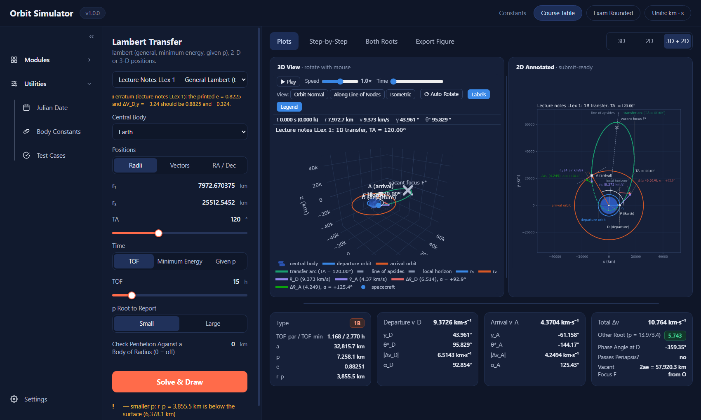
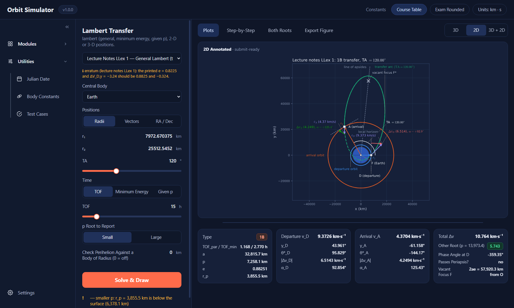
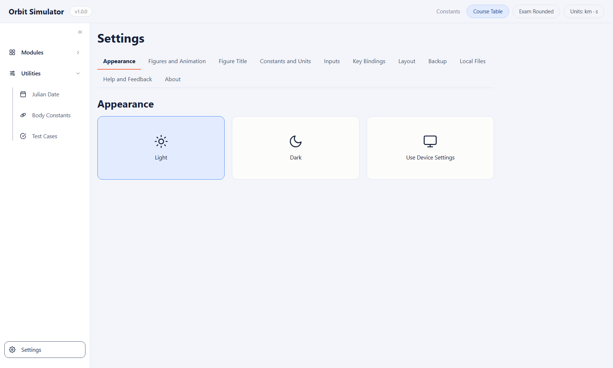

# Orbit Simulator

A desktop app for **orbit-mechanics problems**: it solves the standard two-body / patched-conic problem types step by step, draws annotated 2-D figures
and an interactive 3-D animation, and checks itself against hundreds of published homework and exam answers.



> **Status:** version 1.0.0, **not yet released**. Running from source is tested on Windows 11. The installers have **not been rebuilt for this version**: the Windows wizard has not been run end-to-end, and the macOS packaging has **not been tested on a Mac**.

## What it does

Twelve modules (Bate–Mueller–White conventions; all equations and sign conventions are written out in [`docs/ai_briefing.md`](docs/ai_briefing.md)):

| | Module | | Module |
|---|---|---|---|
| 1 | N-body accelerations | 7 | Single-impulse maneuver (all orbit intersections, minimum Δv) |
| 2 | Two-body constants | 8 | Hohmann / bi-elliptic transfers, phase angle, synodic period |
| 3 | State ⇄ planar conic | 9 | Plane change (single burn vs three burns) |
| 4 | Kepler propagation with f and g (both forms) | 10 | Patched conics (departure and capture hyperbolas) |
| 5 | Hyperbolic flyby geometry | 11 | Gravity assist (both senses, free return) |
| 6 | Elements ⇄ 3-D state with quadrant checks | 12 | Lambert / two-position problems (both p roots) |

* **Step-by-step tables** with the symbol, equation and units of every intermediate value, plus the quadrant and sanity checks that were performed.
* **2-D figures** in the homework style (Cartesian, equal axes, label collision avoidance, your name and the problem label in the title), exported at 300 dpi.
* **3-D animation** with play/pause, 0.1×–10× speed, scrubber, view presets, auto-rotate, label and legend toggles, live readout, optional real planet textures
  and 3-D satellite models. Frames are uniform in *time* (Kepler's equation), so the motion is physically correct.
* **LaTeX everywhere in figures and exports:** labels such as $a_{\mathrm{tot}}$, $\bar v_\infty$, $\theta^{*}$ are typeset with real sub/superscripts; celestial bodies can be shown
  as symbols (R⊕) or as name subscripts ($R_{\mathrm{earth}}$).
* **Export** figures as PNG / PDF, a standalone 3-D page, or a **Python (matplotlib)** or **MATLAB** script that redraws the plots.
* **Homework presets:** every problem with printed answers (HW 3–10, Fall 2024 Exams 1–2, lecture-note examples) loads as a preset, and the *Test Cases* page compares
  computed and printed values. Known errors in the printed solutions are corrected and documented.
* Light / dark / device appearance, rebindable keys, resizable panels, backup & restore of your data, built-in issue reporting.

<details><summary>More screenshots</summary>



</details>

## Installation

### Windows 10 / 11 (installer)

1. Download `OrbitSimulator-Setup-<version>.exe` from the [Releases](https://github.com/Chiyami1213/orbit-simulator/releases) page *(no release is published yet; until then build it yourself, see below)*.
2. Run it. The wizard lets you **choose the install folder**, and choose a **Start Menu shortcut** and/or a **desktop shortcut**. It can also open the help page and this project page when it finishes.
3. Windows 10 only: if the app opens in your browser instead of its own window, install the free [Microsoft Edge WebView2 Runtime](https://developer.microsoft.com/microsoft-edge/webview2/). Windows 11 already includes it.

The installer is per-user by default (no administrator rights needed) and can be switched to an all-users install in the first dialog.

### macOS 12+ (disk image)

1. Download `OrbitSimulator-<version>-macOS.dmg` from the Releases page, open it and drag **Orbit Simulator** onto **Applications**.
2. The app is **not notarised** (that needs a paid Apple developer account). On first launch use **right-click → Open**, or run
   `xattr -dr com.apple.quarantine "/Applications/Orbit Simulator.app"` once.
3. F-keys: on a Mac the function keys may need the `fn` key; every key can be changed in *Settings → Key Bindings*.
4. Screenshots (`F2`) need *Screen Recording* permission for the app the first time (System Settings → Privacy & Security).

### From source (any platform)

```bash
git clone https://github.com/Chiyami1213/orbit-simulator.git
cd orbit-simulator
pip install -r requirements.txt
python run.py              # own window (Edge WebView2 on Windows, WebKit on macOS)
python run.py --browser    # or in your default browser
```

Python 3.10 or newer (developed on 3.12).

## System requirements

| | Minimum | Recommended |
|---|---|---|
| **OS** | Windows 10 (1809+) 64-bit · macOS 12 Monterey | Windows 11 · macOS 13 or newer |
| **Runtime** | Windows: Microsoft Edge WebView2 Runtime (built into Windows 11) · macOS: built-in WebKit | — |
| **CPU** | 64-bit dual-core, ~2 GHz | 4+ cores (Apple silicon or Intel) |
| **Memory** | 4 GB | 8 GB or more |
| **Graphics** | any GPU with **WebGL** support (DirectX 11 / Metal); integrated graphics are fine at *Low–Medium* animation resolution | a dedicated GPU for *High / Ultra* resolution and real planet textures |
| **Display** | 1280 × 720 | 1920 × 1080 |
| **Disk** | ~600 MB free | — |
| **Network** | not needed (everything runs and renders offline) | — |

The 3-D view and animation depend on the graphics card (WebGL). The app can show a frame-rate monitor (*Settings → Figures and Animation → Frame Rate Monitor*) and your graphics card
name (*Settings → Help and Feedback*). If the 3-D view is slow, lower *Animation Resolution*, switch *3D Bodies* to *Plain Color*, or choose *2D* only.
*These figures are estimates; the program has not been benchmarked on low-end hardware.*

## Using it

1. Open **Modules** in the left menu and pick a module (or press <kbd>S</kbd> for settings).
2. Load a homework or exam problem from the drop-down, or enter your own values. Distances can be entered in km, in body radii, or in AU.
3. Results, figures and the animation update as you type. Enter your name under *Settings → Figure Title*: it is printed in every figure title.

| Key | Action | Key | Action |
|---|---|---|---|
| `F5` | refresh the screen | `S` | open / close settings |
| `F2` | screenshot of the window | `M` | hide / show the menu bar |
| `F11` | full screen | | *(all rebindable)* |

Drag the borders between panels to resize them (double-click a border to reset); fold the menu to icons with the arrow at its top.

### Where your files go

Everything the program writes on your computer goes to your per-user application-data folder and is **never uploaded** and **never committed**:

| OS | Folder |
|---|---|
| Windows | `%APPDATA%\Orbit Simulator\` |
| macOS | `~/Library/Application Support/Orbit Simulator/` |
| Linux | `~/.local/share/Orbit Simulator/` |

It contains `settings.json`, `screenshots/`, `exports/`, `backups/` and `logs/`. *Settings → Backup* creates, restores and **imports** backup archives (a safety backup is made before every restore),
and *Settings → Local Files* opens the folders. Uninstalling keeps this folder.

### Reporting a problem

*Settings → Help and Feedback → Report an Issue* opens a pre-filled GitHub issue (version, OS, graphics card, last log lines with your user name removed). You review it and press submit yourself; nothing is sent automatically.

## Building the installers

Build output is written to your application-data folder (`…/Orbit Simulator/build`), never into the repository.

```powershell
# Windows  (needs Python, and Inno Setup 6 for the wizard: winget install JRSoftware.InnoSetup)
powershell -ExecutionPolicy Bypass -File packaging\build.ps1
```
```bash
# macOS  (must be run on a Mac)
bash packaging/build_mac.sh
```

`.github/workflows/build.yml` builds both on real Windows and macOS runners. It runs **only** when started by hand or when you push a version tag such as `v1.0.0`; a tag push also publishes the two files as a GitHub release.

## For developers

```text
mathkit/core/       verified math (ported from the reference implementation without formula changes)
mathkit/modules/    the 12 problem modules;  mathkit/registry.py maps form fields to them
mathkit/presets/    every homework / exam problem with printed answers (also the Test Cases page)
mathkit/plots2d/    matplotlib figures;      mathkit/view3d/  Plotly 3-D scenes, animation page, textures, satellite models
mathkit/ui/         local JSON API + server, LaTeX converter, code export, backup, the HTML/CSS/JS front end (ui/web/)
mathkit/assets/     planet textures
packaging/          PyInstaller spec, Inno Setup wizard, macOS build script, installer artwork
docs/               help page, installer text, screenshots, briefing for AI assistants
tests/              pytest
```

```bash
pip install -r requirements-dev.txt
python -m pytest                      # core + presets + figures + API + export + backup + text-case rules
python -m pytest tests/test_hw.py tests/test_presets.py   # the fast math checks (~1 s)
```

The tests never touch your real data folder (they use a temporary one). Architecture note: the front end is plain HTML/CSS/JS served by a tiny local server bound to `127.0.0.1`, shown in a native window by `pywebview`; all math runs in Python.

## Known limitations

* Two-body / patched-conic analytics only: no numerical propagation, no perturbations (except the N-body acceleration module), no ephemerides (planets on circular orbits of mean radius).
* Lambert: zero full revolutions in the interface. Gravity assists and patched conics are planar.
* Formulas and equations shown in the *results tables* of the app window still use Unicode symbols; LaTeX typesetting is applied to figures and exported files.
* 3-D labels use real sub/superscripts but not full LaTeX (WebGL text cannot typeset it).
* The macOS packaging is untested; the app is unsigned and not notarised.

## Credits and licence

* Planet texture maps in `mathkit/assets/textures` appear to be **Solar System Scope** 2k textures (CC BY 4.0, <https://www.solarsystemscope.com/textures/>); attribution is required and the licence should be confirmed by the project owner before redistribution.
* Equations follow Bate, Mueller & White, *Fundamentals of Astrodynamics*, and the course notes the homework was set from.
* **No licence has been chosen for this project yet**, so by default all rights are reserved. Add a `LICENSE` file before accepting contributions or redistributing.
